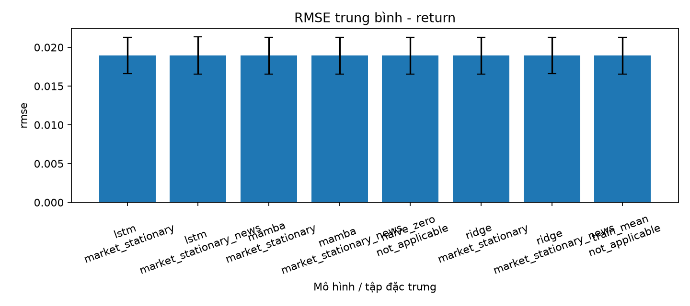
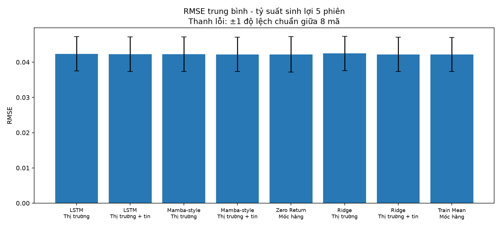
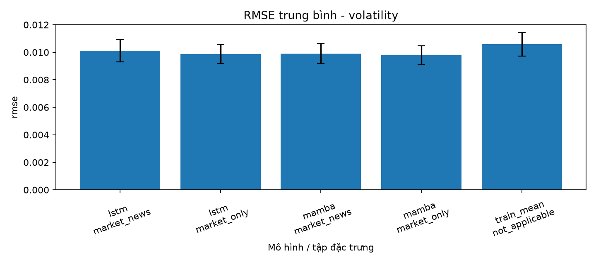

# BÁO CÁO NGHIÊN CỨU KHOA HỌC

## Ứng dụng mô hình Mamba đa biến trên dữ liệu đa nguồn từ thị trường và tâm lý tin tức trong dự báo tỷ suất sinh lợi và độ biến động cổ phiếu ngành ngân hàng Việt Nam

## Tóm tắt

Nghiên cứu đánh giá khả năng dự báo tỷ suất sinh lợi và độ biến động của tám cổ phiếu ngân hàng Việt Nam bằng mô hình chuỗi đa biến. Hai kiến trúc được khảo sát là Long Short-Term Memory (LSTM) và một Selective State Space Model tối giản lấy cảm hứng từ Mamba. Dữ liệu đầu vào gồm các đặc trưng thị trường có tính ổn định và hai đặc trưng tin tức: điểm cảm xúc trung bình và số lượng tiêu đề theo mã cổ phiếu, phiên giao dịch. Dữ liệu thị trường và tin tức bao phủ giai đoạn 2020–2026; tập dữ liệu tin sau lọc gồm 14.090 tiêu đề. Mẫu được chia theo thời gian thành train, validation và test để hạn chế rò rỉ thông tin. Các mô hình được đánh giá với Train Mean, Zero Return và Ridge, sử dụng RMSE, MAE, $R^2_{OOS}$, Directional Accuracy và QLIKE.

Ma trận chính gồm 568 lượt chạy và 249.352 dự báo. Đối với return một phiên, cấu hình Mamba-style kết hợp tin tức đạt RMSE 0,018923 và $R^2_{OOS}=-0,000126$, tiến gần nhưng chưa vượt Train Mean. Kết quả return 5 phiên cũng chưa vượt baseline. Đối với volatility 5 phiên, LSTM dùng dữ liệu thị trường đạt RMSE 0,009671 và $R^2_{OOS}=0,147791$, là cấu hình tốt nhất. Việc bổ sung đặc trưng tin tức không tạo cải thiện ổn định trên đa số mã và seed. Kết quả cho thấy volatility dễ dự báo hơn return trong phạm vi dữ liệu hiện có; đồng thời nhấn mạnh yêu cầu đánh giá nghiêm ngặt đối với chất lượng sentiment trước khi kết luận về giá trị của tin tức.

**Từ khóa:** Mamba, Selective State Space Model, LSTM, cổ phiếu ngân hàng, tỷ suất sinh lợi, độ biến động, sentiment, dữ liệu đa nguồn.

---

## 1. Đặt vấn đề

### 1.1 Bối cảnh nghiên cứu

Dự báo thị trường tài chính là bài toán khó do tỷ suất sinh lợi có nhiễu lớn, phân phối thay đổi theo thời gian và chịu tác động của thông tin mới. Trong khi đó, độ biến động thường thể hiện tính dai dẳng, tạo điều kiện thuận lợi hơn cho mô hình chuỗi thời gian. Dữ liệu OHLCV phản ánh diễn biến giao dịch đã xảy ra nhưng không biểu diễn trực tiếp kỳ vọng của nhà đầu tư. Tin tức tài chính có thể bổ sung thông tin về lợi nhuận, nợ xấu, chính sách, xử phạt hoặc thay đổi quản trị trước khi ảnh hưởng được phản ánh đầy đủ vào lịch sử giá.

LSTM là mô hình hồi quy tuần tự phổ biến, được thiết kế nhằm xử lý phụ thuộc dài hạn trong chuỗi [Hochreiter và Schmidhuber, 1997](https://doi.org/10.1162/neco.1997.9.8.1735). Mamba sử dụng Selective State Space Model với tham số phụ thuộc đầu vào, cho phép mô hình lựa chọn thông tin cần duy trì hoặc loại bỏ theo thời gian [Gu và Dao, 2023](https://arxiv.org/abs/2312.00752). Nghiên cứu này khảo sát khả năng áp dụng ý tưởng selective state space cho dữ liệu tài chính đa biến ở quy mô phù hợp với một đề tài đại học.

### 1.2 Lý do lựa chọn đề tài

Các nghiên cứu dự báo return dễ đánh giá quá cao mô hình nếu chỉ báo cáo độ phù hợp trong mẫu hoặc không sử dụng baseline đủ mạnh. Trong đánh giá ngoài mẫu, trung bình lịch sử là một mốc quan trọng; ngay cả mô hình có quan hệ trong mẫu cũng có thể không vượt được mốc này trong thời gian dài [Campbell và Thompson, 2008](https://dash.harvard.edu/entities/publication/73120378-7dd1-6bd4-e053-0100007fdf3b). Vì vậy, nghiên cứu sử dụng Train Mean làm mẫu số của $R^2_{OOS}$ và giữ nguyên các kết quả âm.

Đề tài đồng thời phân biệt hai câu hỏi thường bị trộn lẫn:

- kiến trúc Mamba-style có tốt hơn LSTM khi đầu vào giống nhau hay không;
- tin tức có tạo giá trị tăng thêm khi giữ nguyên kiến trúc hay không.

## 2. Mục tiêu, câu hỏi và phạm vi nghiên cứu

### 2.1 Mục tiêu

1. Xây dựng quy trình đồng bộ dữ liệu thị trường và tin tức theo thời gian mà không sử dụng thông tin tương lai.
2. So sánh LSTM với Selective SSM Mamba-style trên cùng tập đặc trưng.
3. Đánh giá giá trị tăng thêm của sentiment và số lượng tin so với dữ liệu thị trường.
4. Báo cáo kết quả theo từng mã, nhiều seed và toàn bộ nhóm cổ phiếu.
5. Đảm bảo kết quả có thể tái lập thông qua manifest, checksum và kiểm thử tự động.

### 2.2 Câu hỏi nghiên cứu

- **RQ1:** LSTM và Mamba-style có vượt Train Mean trong dự báo return ngoài mẫu hay không?
- **RQ2:** Hai kiến trúc có vượt Train Mean trong dự báo volatility ngoài mẫu hay không?
- **RQ3:** Trên cùng kiến trúc, `Market stationary + News` có tốt hơn `Market stationary` hay không?
- **RQ4:** Kết quả có ổn định giữa các mã cổ phiếu và các khởi tạo ngẫu nhiên hay không?

### 2.3 Phạm vi

Nghiên cứu sử dụng tám cổ phiếu ngân hàng: `VCB`, `BID`, `CTG`, `MBB`, `TCB`, `ACB`, `VPB`, `STB`. Mỗi mã được huấn luyện riêng. VN-Index được dùng làm biến thị trường chung. Dữ liệu thị trường kéo dài từ 02/01/2020 đến 12/10/2026.

## 3. Cơ sở phương pháp

### 3.1 LSTM

LSTM sử dụng các cổng để điều tiết việc ghi, quên và truyền thông tin trong trạng thái ẩn. Trong nghiên cứu này, LSTM đóng vai trò mô hình đối chứng cho Mamba-style. Đầu vào có dạng `[batch, window, features]`; trạng thái cuối được đưa qua lớp hồi quy để tạo một dự báo.

### 3.2 Selective State Space Model

Mô hình nghiên cứu triển khai một Selective SSM tối giản:

$$
h_t=A_t\odot h_{t-1}+B_t\odot x_t,
$$

$$
o_t=C_t\odot h_t+D\odot x_t.
$$

$A_t$, $B_t$ và $C_t$ phụ thuộc vào đầu vào, nhờ đó mô hình có thể điều chỉnh động lực trạng thái theo từng quan sát. Causal convolution được sử dụng để không truy cập tương lai. Hiện thực này lấy cảm hứng từ Mamba nhưng không phải bản benchmark chính thức của thư viện `mamba_ssm`; vì vậy báo cáo sử dụng tên **Mamba-style Selective SSM**.

### 3.3 Phân tích cảm xúc tin tức

Phiên bản hiện tại không sử dụng PhoBERT. Sentiment được tính bằng từ điển tài chính tiếng Việt trên tiêu đề, gồm các bước chuẩn hóa văn bản, dò cụm từ tích cực/tiêu cực, cộng trọng số và chuẩn hóa điểm về `[-1,1]`. Đây là baseline NLP minh bạch nhưng không hiểu đầy đủ phủ định, đa nghĩa hoặc quan hệ ngữ cảnh.

PhoBERT là mô hình ngôn ngữ tiền huấn luyện đơn ngữ cho tiếng Việt [Nguyen và Nguyen, 2020](https://aclanthology.org/2020.findings-emnlp.92/). Việc fine-tune PhoBERT cho cảm xúc tài chính là một hướng phát triển, không phải thành phần của kết quả hiện tại.

## 4. Dữ liệu

### 4.1 Dữ liệu thị trường

Dữ liệu gồm `time`, `open`, `high`, `low`, `close`, `volume` của tám mã và VN-Index. Các tệp được kiểm tra cột bắt buộc, thứ tự thời gian, ngày trùng, giá trị không hữu hạn và quy tắc OHLC. Snapshot có khoảng 1.689 phiên cho mỗi chuỗi, riêng ACB có 1.684 phiên.

### 4.2 Dữ liệu tin tức

Google News RSS được sử dụng như công cụ truy hồi metadata. Truy vấn dựa trên tên thương hiệu và tên đầy đủ của từng ngân hàng. Chỉ các tiêu đề nhắc trực tiếp đúng ngân hàng mới được giữ lại; bản ghi trùng được loại theo URL hoặc tiêu đề–ngày.

| Mã | Train | Validation | Test | Tổng số tiêu đề |
|---|---:|---:|---:|---:|
| VCB | 677 | 357 | 1.315 | 2.349 |
| BID | 520 | 241 | 1.061 | 1.822 |
| CTG | 907 | 556 | 1.499 | 2.962 |
| MBB | 203 | 102 | 249 | 554 |
| TCB | 532 | 278 | 1.140 | 1.950 |
| ACB | 169 | 82 | 296 | 547 |
| VPB | 761 | 319 | 1.223 | 2.303 |
| STB | 343 | 203 | 1.057 | 1.603 |
| **Tổng** | **4.112** | **2.138** | **7.840** | **14.090** |

Dự án chỉ lưu metadata, tiêu đề và liên kết, không lưu toàn văn bài báo. Snapshot
dữ liệu được lưu cùng repository để tái lập lần thực nghiệm; checksum trong
manifest dùng để kiểm tra tính nhất quán. Quyền đối với dữ liệu gốc vẫn thuộc
nhà cung cấp và nhà xuất bản tương ứng.

### 4.3 Đồng bộ thời gian

Gọi $c=15{:}00$ là cutoff. Tin trước cutoff được gán cho phiên cùng ngày nếu đó là ngày giao dịch. Tin từ cutoff trở đi, tin cuối tuần và ngày nghỉ được gán cho phiên giao dịch kế tiếp. Cách đồng bộ này ngăn tin xuất hiện sau thời điểm dự báo bị sử dụng cho một quan sát quá khứ.

Trên từng mã và phiên:

$$
s_t=\frac{1}{n_t}\sum_{i\in\mathcal N_t}s_i,
\qquad n_t=|\mathcal N_t|.
$$

Nếu không có tin, đặt `sentiment_score = 0` và `news_count = 0`.

## 5. Xây dựng đặc trưng và biến mục tiêu

### 5.1 Đặc trưng thị trường

Với giá đóng cửa $P_t$, giá mở cửa $O_t$, mức cao/thấp $H_t,L_t$, khối lượng $V_t$ và VN-Index $I_t$:

$$
r_t=\ln(P_t/P_{t-1}),\qquad
r_t^{VN}=\ln(I_t/I_{t-1}),
$$

$$
r_t^{intra}=\ln(P_t/O_t),\qquad
r_t^{overnight}=\ln(O_t/P_{t-1}),
$$

$$
\Delta V_t=V_t/V_{t-1}-1,
\qquad q_t=(H_t-L_t)/P_t.
$$

Các đặc trưng bổ sung gồm volatility lịch sử 5/20 phiên, momentum 5/20 phiên, z-score khối lượng 20 phiên, momentum VN-Index 5 phiên và return tương đối $r_t-r_t^{VN}$. Việc dùng biến biến đổi thay cho mức giá tuyệt đối nhằm giảm ảnh hưởng của xu hướng và khác biệt thang đo giữa các mã.

### 5.2 Tập đặc trưng

- `Market stationary`: 13 đặc trưng thị trường.
- `Market stationary + News`: 13 đặc trưng thị trường cộng `sentiment_score` và `news_count`.

Hai cấu hình legacy loại riêng sentiment hoặc news count vẫn có trong mã nguồn nhưng không thuộc ma trận chính lần này.

### 5.3 Target return

$$
y_{t,h}^{(r)}=\sum_{j=1}^{h}r_{t+j},\qquad h\in\{1,5\}.
$$

Horizon 1 là bài toán chính; horizon 5 là phân tích bổ sung nhằm kiểm tra liệu tích lũy nhiều phiên có giảm nhiễu hay không.

### 5.4 Target volatility

$$
y_t^{(\sigma)}=\sqrt{\frac{1}{5}\sum_{j=1}^{5}r_{t+j}^2}.
$$

Đây là realized volatility chưa annualize. Ngày của nhãn là ngày cuối trong horizon tương lai.

## 6. Thiết kế thực nghiệm

### 6.1 Chia dữ liệu

| Tập | Ngày kết thúc target | Vai trò |
|---|---|---|
| Train | đến 31/12/2023 | Fit scaler, tham số và ngưỡng loss |
| Validation | 01/01/2024–31/12/2024 | Early stopping, chọn Ridge alpha và shrinkage |
| Test | từ 01/01/2025 | Đánh giá cuối cùng |

Mẫu được chia theo ngày cuối target, không theo ngày đầu cửa sổ. Scaler đặc trưng và target chỉ được fit bằng train.

### 6.2 Baseline

- **Zero Return:** $\hat y_t=0$, chỉ áp dụng cho return.
- **Train Mean:** $\hat y_t=\bar y_{train}$.
- **Ridge:** trải phẳng cửa sổ 30 phiên và chọn $\alpha\in\{1,10,100,10^3,10^4,10^5\}$ theo MSE validation. Volatility Ridge học trên $\log(\max(y,\epsilon))$ rồi biến đổi ngược để dự báo luôn dương.

### 6.3 Huấn luyện mạng

| Thuộc tính | Giá trị |
|---|---|
| Cửa sổ | 30 phiên |
| Epoch tối đa | 40 |
| Batch size | 128 |
| Optimizer | AdamW |
| Weight decay | $10^{-4}$ |
| Loss return | Huber |
| Loss volatility | MSE |
| Early stopping patience | 8 epoch |
| Seed | 42, 52, 62, 72, 82 |

Để hạn chế dự báo return quá cực đoan, hệ số co được ước lượng chỉ trên validation:

$$
\alpha^*=\operatorname{clip}_{[0,1]}
\frac{(\hat y^{val}-\bar y_{train})^\top(y^{val}-\bar y_{train})}
{\|\hat y^{val}-\bar y_{train}\|_2^2},
$$

$$
\hat y^{shrunk}=\bar y_{train}+\alpha^*(\hat y-\bar y_{train}).
$$

Test không được sử dụng để chọn epoch, alpha Ridge, hệ số shrinkage hoặc feature.

### 6.4 Quy mô thí nghiệm

Ma trận gồm 568 lượt chạy:

- return h1: 192 lượt;
- return h5: 192 lượt;
- volatility h5: 184 lượt.

Tổng cộng có 249.352 dự báo theo ngày. Không mã hoặc seed nào bị loại khỏi tổng hợp.

## 7. Chỉ số và kiểm định

$$
RMSE=\sqrt{\frac1N\sum_i(y_i-\hat y_i)^2},
\qquad
MAE=\frac1N\sum_i|y_i-\hat y_i|.
$$

$$
R^2_{OOS}=1-\frac{\sum_i(y_i-\hat y_i)^2}
{\sum_i(y_i-\hat y_i^{TrainMean})^2}.
$$

Train Mean có $R^2_{OOS}=0$. Giá trị dương thể hiện mô hình có MSE nhỏ hơn Train Mean; giá trị âm thể hiện mô hình kém baseline.

Return báo cáo thêm Directional Accuracy:

$$
DA=\frac1N\sum_i\mathbf 1[\operatorname{sign}(y_i)=\operatorname{sign}(\hat y_i)].
$$

Volatility báo cáo QLIKE trên variance. Kiểm định HAC sử dụng chênh lệch squared loss giữa mô hình và Train Mean trên cùng ngày test. Với target nhiều phiên chồng lấn, độ trễ HAC tối thiểu là $H-1$.

## 8. Kết quả

### 8.1 Return một phiên

| Mô hình | Tập đặc trưng | RMSE | MAE | $R^2_{OOS}$ | DA |
|---|---|---:|---:|---:|---:|
| Train Mean | Không áp dụng | **0,018921** | 0,012921 | 0,000000 | 0,462415 |
| Zero Return | Không áp dụng | 0,018928 | **0,012859** | -0,000528 | 0,078588 |
| Ridge | Market stationary | 0,018936 | 0,012936 | -0,001688 | 0,465831 |
| Ridge | Market stationary + News | 0,018939 | 0,012954 | -0,002257 | 0,460421 |
| LSTM | Market stationary | 0,018954 | 0,012962 | -0,003499 | 0,466629 |
| LSTM | Market stationary + News | 0,018964 | 0,012967 | -0,004419 | **0,469476** |
| Mamba-style | Market stationary | 0,018934 | 0,012939 | -0,001434 | 0,467084 |
| Mamba-style | Market stationary + News | 0,018923 | 0,012929 | **-0,000126** | 0,463952 |

Train Mean có RMSE thấp nhất. Mamba-style kết hợp news là mạng gần baseline nhất, nhưng $R^2_{OOS}$ vẫn âm nhẹ. DA cao hơn 0,5 không xuất hiện trên trung bình nhóm; vì vậy chưa có bằng chứng về khả năng dự báo hướng ổn định.

### 8.2 Return năm phiên

| Mô hình | Tập đặc trưng | RMSE | MAE | $R^2_{OOS}$ | DA |
|---|---|---:|---:|---:|---:|
| Train Mean | Không áp dụng | **0,042155** | 0,029591 | 0,000000 | 0,520216 |
| Zero Return | Không áp dụng | 0,042214 | **0,029523** | -0,001933 | 0,000000 |
| Ridge | Market stationary | 0,042462 | 0,030006 | -0,014534 | 0,507403 |
| Ridge | Market stationary + News | 0,042363 | 0,029833 | -0,010069 | 0,519362 |
| LSTM | Market stationary | 0,042368 | 0,029718 | -0,010051 | 0,516287 |
| LSTM | Market stationary + News | 0,042251 | 0,029658 | -0,004272 | **0,524601** |
| Mamba-style | Market stationary | 0,042262 | 0,029652 | -0,004833 | 0,520501 |
| Mamba-style | Market stationary + News | 0,042208 | 0,029654 | **-0,002362** | 0,517084 |

Kéo dài horizon lên 5 phiên chưa giúp các mô hình vượt Train Mean trên trung bình nhóm. Mamba-style + News vẫn là mạng có $R^2_{OOS}$ gần 0 nhất.

### 8.3 Volatility năm phiên

| Mô hình | Tập đặc trưng | RMSE | MAE | $R^2_{OOS}$ | QLIKE |
|---|---|---:|---:|---:|---:|
| Train Mean | Không áp dụng | 0,010491 | 0,008567 | 0,000000 | 0,692076 |
| Log-Ridge | Market stationary | 0,010239 | 0,007208 | 0,046680 | 0,862484 |
| Log-Ridge | Market stationary + News | 0,010447 | 0,007280 | 0,007350 | 1,092153 |
| LSTM | Market stationary | **0,009671** | 0,007276 | **0,147791** | **0,689216** |
| LSTM | Market stationary + News | 0,009756 | **0,007197** | 0,132772 | 0,759970 |
| Mamba-style | Market stationary | 0,009772 | 0,007333 | 0,128632 | 0,730341 |
| Mamba-style | Market stationary + News | 0,009829 | 0,007278 | 0,118622 | 0,784686 |

Các mô hình học được đều có $R^2_{OOS}$ dương ở cấp nhóm. LSTM Market stationary tốt nhất theo RMSE và $R^2_{OOS}$. Mamba-style Market stationary đứng sau LSTM, do đó kết quả không ủng hộ khẳng định Mamba tốt hơn LSTM trong cấu hình hiện tại.

### 8.4 Giá trị tăng thêm của tin tức

| Target | Mô hình | News tốt hơn | Tổng số cặp mã–seed | Cải thiện MSE trung bình |
|---|---|---:|---:|---:|
| Return h1 | LSTM | 19 | 40 | -0,00000049 |
| Return h1 | Mamba-style | 20 | 40 | 0,00000038 |
| Return h5 | LSTM | 17 | 40 | 0,00000998 |
| Return h5 | Mamba-style | 19 | 40 | 0,00000474 |
| Volatility h5 | LSTM | 16 | 40 | -0,00000183 |
| Volatility h5 | Mamba-style | 17 | 40 | -0,00000121 |

Giá trị dương ở cột cuối có lợi cho news. Tuy nhiên, tỷ lệ cải thiện không vượt quá 20/40 đối với mạng và mức cải thiện trung bình rất nhỏ. Với volatility, news làm RMSE nhóm xấu đi ở cả hai kiến trúc. Vì vậy chưa có bằng chứng ổn định rằng hai đặc trưng sentiment/count hiện tại tạo giá trị dự báo tăng thêm.

### 8.5 Biểu đồ

## 9. Thảo luận

### 9.1 Khả năng dự báo return

Return ngắn hạn có tỷ lệ tín hiệu trên nhiễu thấp. Forecast shrinkage làm giảm đáng kể mức thua baseline so với cấu hình mạng không regularize, nhưng không tạo ra $R^2_{OOS}$ dương trên trung bình tám mã. Kết quả này phù hợp với yêu cầu thận trọng trong dự báo return ngoài mẫu: một mô hình phức tạp không mặc nhiên tốt hơn dự báo trung bình lịch sử.

Kết quả âm vẫn có giá trị khoa học. Nó cho thấy các đặc trưng kỹ thuật và sentiment hiện tại chưa đủ để tạo năng lực dự báo return ổn định, đồng thời ngăn việc chọn riêng seed hoặc mã thuận lợi để đưa ra kết luận quá mức.

### 9.2 Khả năng dự báo volatility

Volatility có cấu trúc thời gian rõ hơn return. LSTM và Mamba-style đều vượt Train Mean theo RMSE và $R^2_{OOS}$. Điều này cho thấy cửa sổ lịch sử chứa thông tin hữu ích về mức biến động tương lai. Tuy nhiên, LSTM tốt hơn Mamba-style trong cấu hình chính, vì vậy chưa thể khẳng định kiến trúc Mamba mang lại ưu thế.

### 9.3 Vai trò của tin tức

Tin tức không cải thiện ổn định trên toàn nhóm. Có ba cách giải thích cần được phân biệt:

1. sentiment/count thực sự chỉ mang tín hiệu yếu ở tần suất ngày;
2. tiêu đề và từ điển hiện tại chưa biểu diễn đủ ngữ cảnh tài chính;
3. tác động tin tức khác nhau theo mã, loại sự kiện và trạng thái thị trường nên bị làm loãng khi lấy trung bình ngày.

Không thể kết luận nguyên nhân nào đúng nếu chưa có benchmark sentiment do con người gán nhãn. Mẫu 90 tiêu đề đã được tạo nhưng chưa có nhãn thủ công; do đó phần kết luận về news phải được xem là sơ bộ.

## 10. Độ tin cậy và khả năng tái lập

- 26 kiểm thử tự động kiểm tra target, leakage, cutoff tin, mô hình, baseline và metric.
- Manifest lưu cấu hình, phiên bản môi trường, checksum mã nguồn và checksum dữ liệu.
- Kết quả gồm 568 định danh duy nhất và 249.352 dự báo hợp lệ.
- Mọi dự báo volatility đều dương.
- Báo cáo có bảng từng mã, độ lệch chuẩn seed, tổng hợp nhóm và kiểm định HAC.
- `verify_project.py --require-results` xác nhận đầy đủ số lượt chạy và sự khớp giữa kết quả với manifest.

## 11. Hạn chế

1. Sentiment chỉ dựa trên từ điển và tiêu đề, chưa sử dụng nội dung toàn văn hoặc mô hình ngôn ngữ như PhoBERT.
2. Mẫu sentiment 90 tiêu đề chưa được gán nhãn thủ công, nên chưa có Accuracy và Macro-F1.
3. Google News RSS là chỉ mục động; kết quả truy hồi trong tương lai có thể khác snapshot hiện tại.
4. Selective SSM là bản Mamba-style nhỏ, không phải triển khai Mamba chính thức.
5. Mỗi mã được huấn luyện riêng, chưa khai thác cấu trúc liên mã bằng mô hình pooled.
6. Chưa thực hiện walk-forward retraining hoặc đánh giá chi phí giao dịch.
7. Kết quả chỉ áp dụng cho tập tám cổ phiếu và giai đoạn quan sát; không nên ngoại suy trực tiếp sang ngành khác.

## 12. Kết luận

Nghiên cứu đã xây dựng thành công một pipeline đa nguồn có kiểm soát leakage cho hai bài toán dự báo cổ phiếu ngân hàng Việt Nam. Kết quả chính gồm:

- return một phiên và năm phiên chưa vượt Train Mean trên trung bình nhóm;
- Mamba-style tiến gần baseline hơn LSTM trong phần lớn cấu hình return nhưng chưa tạo $R^2_{OOS}$ dương;
- volatility 5 phiên có khả năng dự báo ngoài mẫu rõ ràng;
- LSTM Market stationary là cấu hình tốt nhất, đạt $R^2_{OOS}=0,147791$;
- Mamba-style vượt Train Mean trong dự báo volatility nhưng chưa vượt LSTM;
- sentiment và news count chưa tạo giá trị tăng thêm ổn định.

Do đó, đóng góp phù hợp nhất của đề tài không phải là khẳng định Mamba luôn vượt trội, mà là xây dựng một quy trình đánh giá minh bạch và chỉ ra sự khác biệt giữa khả năng dự báo return và volatility trên dữ liệu ngân hàng Việt Nam.

## 13. Hướng phát triển

1. Hoàn tất gán nhãn thủ công mẫu sentiment và báo cáo Accuracy, Macro-F1, confusion matrix.
2. Fine-tune PhoBERT trên dữ liệu cảm xúc tài chính Việt Nam và so sánh trực tiếp với từ điển.
3. Phân loại tin theo loại sự kiện thay vì chỉ dùng điểm trung bình và số lượng.
4. Xây dựng mô hình pooled cho tám mã với ticker embedding và ablation tương ứng.
5. Thực hiện walk-forward validation và kiểm tra nhiều giai đoạn thị trường.
6. Đăng ký trước lưới sensitivity cho cửa sổ, cutoff và loss weight; công bố đầy đủ thay vì chọn kết quả tốt nhất trên test.

## Tài liệu tham khảo

1. Campbell, J. Y., & Thompson, S. B. (2008). *Predicting Excess Stock Returns Out of Sample: Can Anything Beat the Historical Average?* The Review of Financial Studies, 21(4), 1509–1531. https://doi.org/10.1093/rfs/hhm055
2. Gu, A., & Dao, T. (2023). *Mamba: Linear-Time Sequence Modeling with Selective State Spaces*. arXiv:2312.00752. https://arxiv.org/abs/2312.00752
3. Hochreiter, S., & Schmidhuber, J. (1997). *Long Short-Term Memory*. Neural Computation, 9(8), 1735–1780. https://doi.org/10.1162/NECO.1997.9.8.1735
4. Nguyen, D. Q., & Nguyen, A. T. (2020). *PhoBERT: Pre-trained language models for Vietnamese*. Findings of EMNLP 2020, 1037–1042. https://doi.org/10.18653/v1/2020.findings-emnlp.92

## Phụ lục: tệp kết quả chính

- [Bảng tổng hợp toàn nhóm](../results/group_summary.csv)
- [Bảng theo từng mã](../results/per_ticker_summary.csv)
- [Kiểm định HAC](../results/statistical_tests.csv)
- [Kiểm định giá trị tin tức](../results/news_value_tests.csv)
- [Manifest thực nghiệm](../results/EXPERIMENT_MANIFEST.json)
- [Báo cáo kết quả tự sinh](../results/BAO_CAO_KET_QUA.md)
