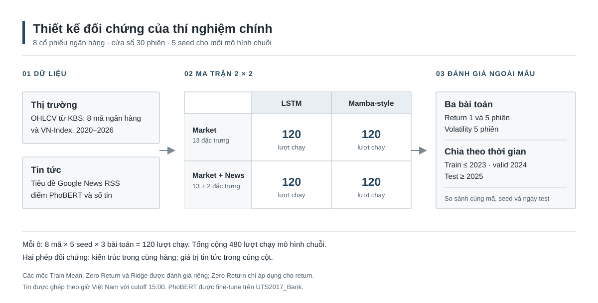

# Thiết kế nghiên cứu và sơ đồ quy trình

## Câu hỏi nghiên cứu

Nghiên cứu kiểm tra (1) mô hình chuỗi có dự báo tỷ suất sinh lợi và độ biến động ngoài mẫu tốt hơn các mốc đơn giản hay không; (2) kiến trúc Selective SSM lấy cảm hứng từ Mamba có lợi thế so với LSTM khi dùng cùng đầu vào hay không; và (3) cảm xúc cùng số lượng tin tức có đóng góp thêm so với chỉ dùng dữ liệu thị trường hay không.

## Hình 1. Ma trận đối chứng của thí nghiệm chính

*Hình 1. Mỗi ô gồm 8 mã × 5 seed × 3 bài toán, tương ứng 120 lượt chạy; bốn ô có 480 lượt chạy. Thêm 88 lượt của Train Mean, Zero Return và Ridge, ma trận chính có 568 lượt. So sánh hai ô cùng cột (cùng kiến trúc) để đo giá trị tăng thêm của tin; so sánh hai ô cùng hàng (cùng tập đặc trưng) để đối chiếu LSTM với Mamba-style.*

PhoBERT chỉ tạo điểm cảm xúc; số tin được đếm riêng. Mỗi mã được huấn luyện riêng, nên không có ticker embedding trong mô hình hiện tại. Những bước xử lý dữ liệu và đánh giá không thể hiện trên hình được mô tả ở các mục dưới đây.

## Quy tắc để các phép so sánh có ý nghĩa

| Phép so sánh | Giữ cố định | Thay đổi | Kết luận có thể rút ra |
|---|---|---|---|
| LSTM và Mamba-style | Mã, target, thời gian, đầu vào, seed | Kiến trúc | Vai trò của kiến trúc trong cấu hình này |
| Market-only và Market + News | Mã, target, kiến trúc, seed, chia tập | Hai đặc trưng tin | Giá trị tăng thêm của sentiment và số tin kết hợp |
| Bỏ sentiment hoặc bỏ số tin | Toàn bộ đặc trưng thị trường ổn định | Một đặc trưng tin | Đóng góp riêng của thành phần bị bỏ; đây là phân tích bổ sung chưa có kết quả trong ma trận chính |
| Mạng và Train Mean | Mã, ngày test, target | Quy tắc dự báo | Có vượt được mốc lịch sử hay không |

Khi viết báo cáo, chỉ mô tả các ablation đã **chạy và công bố kết quả**. Cấu hình hỗ trợ ablation trong code chưa đồng nghĩa thí nghiệm đó đã được thực hiện. Bảng chính đã chạy Market-only và Market + News; kết quả bỏ riêng từng đặc trưng và kiểm tra nhiều cửa sổ/cutoff vẫn là hướng bổ sung.

## Mốc thời gian và chống rò rỉ dữ liệu

Tại thời điểm cuối phiên $t$, cửa sổ đầu vào kết thúc ở $t$. Tin đã xuất bản trước cutoff được ghép vào phiên tương ứng; tin xuất bản từ 15:00, ngày nghỉ hoặc cuối tuần chuyển sang phiên giao dịch kế tiếp. Nhãn return dùng giá sau $t$; nhãn volatility dùng năm log-return tiếp theo. Mẫu được chia theo **ngày cuối của nhãn**, scaler chỉ fit trên train, còn validation chọn epoch, Ridge alpha và hệ số co dự báo. Test chỉ được dùng để tính kết quả cuối.

## Cách diễn giải kết quả hiện tại

- Return một phiên: Mamba-style + News đạt $R^2_{OOS}=-0,000890$ trên trung bình tám mã, chưa vượt Train Mean.
- Volatility năm phiên: LSTM Market-only đạt $R^2_{OOS}=0,147791$; Mamba-style Market-only cũng vượt Train Mean nhưng thấp hơn LSTM.
- PhoBERT + news count chưa cải thiện ổn định so với Market-only. Bộ phân loại PhoBERT chưa nhận diện tốt lớp neutral và cần nhãn tiêu đề chứng khoán do con người gán.

Một đề tài có giá trị khi thiết kế kiểm tra được giả thuyết và công bố cả kết quả không thuận lợi. Không thể bảo đảm mô hình phức tạp sẽ đạt chỉ số dương trên dữ liệu test chưa nhìn thấy. Các cải tiến tiếp theo cần được chọn trên train/validation hoặc tập thời gian mới, rồi công bố đủ cấu hình đã thử.

## Ưu tiên cải thiện có thể thực hiện

1. **Kiểm định cảm xúc trên đúng miền đích:** hai thành viên gán nhãn độc lập mẫu tiêu đề trong `data/news_validation_sample.csv`, thống nhất nhãn bất đồng, rồi chạy `evaluate_sentiment.py` cho PhoBERT và từ điển. Mục tiêu là biết điểm cảm xúc có đáng tin trước khi sửa mô hình dự báo.
2. **Tách giá trị từng biến tin:** chạy chế độ `--include-ablations` với cùng cửa sổ, seed và dữ liệu; công bố cả hai cấu hình bỏ sentiment và bỏ news count. Ma trận 568 lượt hiện tại chưa gồm thử nghiệm này.
3. **Đánh giá trên giai đoạn mới:** nếu điều chỉnh đặc trưng hoặc siêu tham số dựa trên kết quả hiện tại, giai đoạn test 2025–2026 không còn là test độc lập cho phương án mới. Cần giữ nguyên nó như kết quả gốc và dùng một giai đoạn tương lai chưa quan sát để xác nhận cải thiện.

Không dùng việc chọn riêng mã cổ phiếu, seed, cutoff hay độ dài cửa sổ có RMSE đẹp nhất trên test làm kết luận chính. Tỷ suất sinh lợi ngắn hạn có thể không dự báo tốt hơn Train Mean ngay cả khi quy trình được thực hiện đúng.
